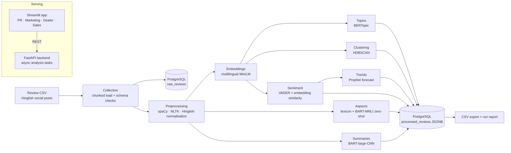

# KnowMySocials

**NLP pipeline and role-based dashboards for analysing Hinglish two-wheeler reviews from social media.**

KnowMySocials takes raw customer reviews (Hindi-English code-mixed text from sources such as YouTube comments, Instagram, Team-BHP and BikeWale), cleans them, and turns them into structured insight: topics, sentiment, aspect-level opinions, summaries and sentiment trends. The results are served through a FastAPI backend and explored in Streamlit dashboards built for PR, Marketing, Dealer and Sales teams.

> Built by **Shivatmika Baranwal** during an IT internship at **Honda Motorcycle & Scooter India** (IT Department, May–Jul 2026) as the project *Customer Sentiments using AI*.

---

## Highlights

- **Hinglish-aware preprocessing**: URL/HTML/special-character cleanup, Hinglish normalisation, language detection, spaCy lemmatisation, NLTK stopwords, and a rule-based fast path for simple reviews with parallel processing for the rest.
- **Multilingual embeddings** with `paraphrase-multilingual-MiniLM-L12-v2` (Sentence-Transformers), with a deterministic fallback if the model is unavailable.
- **Topic discovery** with BERTopic (UMAP + HDBSCAN + CountVectorizer), plus standalone HDBSCAN clustering.
- **Hybrid sentiment**: VADER scores combined with embedding similarity to positive/negative reference sentences and domain keyword boosts.
- **Aspect extraction**: keyword lexicons (mileage, engine, comfort, heat, noise, service, braking, storage and more) plus zero-shot aspect tagging with `facebook/bart-large-mnli`.
- **Abstractive summaries** with `facebook/bart-large-cnn`.
- **Trend analysis**: sentiment over time with Prophet forecasting, and a simple fallback when Prophet isn't installed.
- **Storage**: raw, preprocessed and processed reviews in PostgreSQL (SQLAlchemy, JSONB fields), with a run report and CSV export.
- **Serving**: a FastAPI service with asynchronous analysis tasks (`/analyze`, `/status/{id}`, `/results/{id}`) and a Streamlit app with role-based logins and Plotly charts.

## Architecture



## Pipeline stages (`main_final.py`)

| # | Stage | Module |
|---|---|---|
| 1 | Data collection: load CSV in chunks, validate schema and data quality | `src/collection.py` |
| 2 | Ingestion: create schema and store raw reviews and metadata in PostgreSQL | `src/ingestion.py` |
| 3 | Hybrid preprocessing: rule-based fast path plus parallel spaCy processing | `src/preprocessing.py` |
| 4 | Sentence embeddings | `src/embedding.py` |
| 5 | Topic discovery with BERTopic | `src/topic_modeling.py` |
| 6 | HDBSCAN clustering | `src/clustering.py` |
| 7 | Hybrid sentiment and aspect-level sentiment | `src/sentiment.py` |
| 8 | Abstractive summarisation and zero-shot aspect classification | `src/summarization.py` |
| 9 | Sentiment trend analysis and Prophet forecasting | `src/trend_prediction.py` |
| 10 | Structured output: merge results, store as JSONB, export CSV, write run report | `main_final.py` |

`main.py` runs the earlier, shorter pipeline (collection → ingestion → preprocessing → embeddings/topics/clustering). `run_dry_pipeline.py` runs preprocessing, embeddings, topics and clustering in memory without a database.

**Note on the API:** `backend/main.py` is a lightweight serving layer for the dashboards. It runs its own fast lexicon-based sentiment and keyword aggregation per request, so the dashboards respond quickly. It does not load the transformer models. The full transformer pipeline above runs as a batch job through `main_final.py`.

## Tech stack

| Area | Tools |
|---|---|
| Language | Python 3.10+ |
| NLP / ML | spaCy, NLTK (VADER), Sentence-Transformers, Hugging Face Transformers (BART-large-CNN, BART-large-MNLI), BERTopic, UMAP, HDBSCAN, scikit-learn, PyTorch |
| Forecasting | Prophet (optional) |
| Data | pandas, NumPy, PostgreSQL, SQLAlchemy, psycopg2 |
| Serving / UI | FastAPI, Uvicorn, Pydantic, Streamlit, Plotly |

## Getting started

### 1. Install

```bash
git clone https://github.com/Damselnodistress5/KnowMySocials.git
cd KnowMySocials
python3 -m venv venv && source venv/bin/activate
pip install -r requirements.txt
python -m spacy download en_core_web_sm
pip install prophet        # optional, enables Prophet trend forecasting
```

### 2. Configure the database (for the batch pipeline)

```bash
cp .env.example .env       # then set DB_HOST, DB_PORT, DB_NAME, DB_USER, DB_PASSWORD
createdb knowmysocials_db  # tables are created by the pipeline on first run
```

### 3. Run the NLP pipeline

```bash
python main_final.py                               # uses data/sample_reviews.csv by default
SAMPLE_CSV=honda_reviews.csv python main_final.py  # run on the full 5,500-review dataset
python run_dry_pipeline.py                         # quick in-memory run, no database
```

The transformer models download automatically on first run. A GPU is optional but makes summarisation and zero-shot tagging much faster.

### 4. Run the API and dashboards

```bash
# terminal 1: FastAPI backend on http://127.0.0.1:8000 (interactive docs at /docs)
uvicorn main:app --app-dir backend --reload --port 8000

# terminal 2: Streamlit frontend on http://localhost:8501
streamlit run app.py
```

Pick a role (PR, Marketing, Dealer or Sales), sign in with the demo credentials defined in `app.py`, and upload a review CSV or use the built-in sample reviews. Uploaded CSVs are matched to the columns `review_id, text, region, model, feature, campaign, price_tier`, and common synonyms such as `review` and `model_name` are recognised. Results are written to `backend/results/`, which is git-ignored.

## Project structure

```
KnowMySocials/
├── main_final.py          # full pipeline orchestrator (all stages)
├── main.py                # phase-1 pipeline orchestrator
├── run_dry_pipeline.py    # in-memory dry run (no DB)
├── config.py              # DB, model, path and pipeline settings
├── app.py                 # Streamlit role-based dashboards
├── backend/
│   └── main.py            # FastAPI service (async analysis tasks)
├── src/
│   ├── collection.py      # CSV loading and validation
│   ├── ingestion.py       # PostgreSQL schema and inserts
│   ├── preprocessing.py   # Hinglish-aware cleaning and lemmatisation
│   ├── embedding.py       # Sentence-Transformer embeddings
│   ├── topic_modeling.py  # BERTopic
│   ├── clustering.py      # HDBSCAN
│   ├── sentiment.py       # hybrid sentiment and aspects
│   ├── summarization.py   # BART summaries and zero-shot aspects
│   ├── trend_prediction.py# trends and Prophet forecasting
│   └── utils.py           # logging and DB helpers
├── scripts/
│   ├── export_reviews.py
│   ├── run_dummy_sentiment_test.py
│   └── dev/               # smoke tests and graph scripts
├── data/                  # synthetic / sample review datasets
└── docs/                  # detailed design notes and guides
```

## Data

The datasets in `data/` are **synthetic, templated sample reviews** generated for development and testing (`honda_reviews.csv` has 5,500 rows and `dummy_reviews_6000.csv` has 6,000). They mimic the style of public Hinglish social-media reviews. They are not real customer data and not Honda internal data. Smaller files (`sample_reviews.csv`, `sample_100_reviews.csv`) are used for quick runs, and `reviews_final_structured.csv` is an example of the pipeline's structured output.

## Documentation

More detailed design notes, setup guides and implementation summaries are in [`docs/`](docs/README.md).

## Author

**Shivatmika Baranwal**, B.Tech Computer Engineering, NMIMS Indore · [GitHub](https://github.com/Damselnodistress5)
